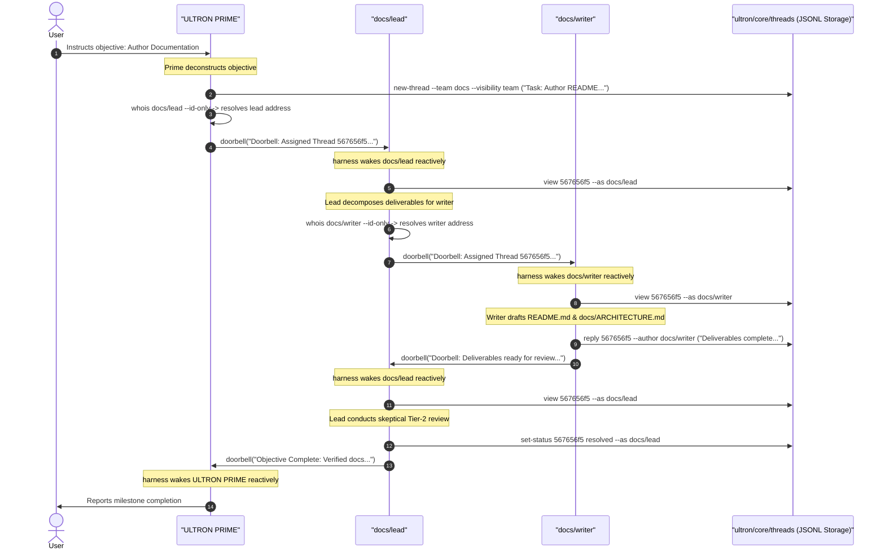

# ULTRON Technical Architecture Specification

**Universal Layered Team and Role Orchestration Network (ULTRON)**  
*Document Version:* 2.0.0 · *Status:* As-Implemented Specification · *Storage Engine:* Pure Git-Native (Zero SQLite)

**New in v2:** one product, many harnesses. The core names no harness; each harness is an adapter
(§8). Teams in one hive can run on different harnesses (mixed hives), woken across harnesses by a
shell doorbell (§7.2). Also new: `spawn-team` / `stop-team` / `liveness` (§5), neutral model tiers,
and a role guard on lifecycle commands (§2.3). v1 described Antigravity only; it is in git history.

---

## 1. Executive Summary & Design Philosophy

Autonomous agent systems operating in complex software engineering repositories face fundamental scaling bottlenecks:
1. **Context Dilution & Distraction:** Flat multi-agent networks broadcast messages globally or rely on monolithic conversation histories, rapidly consuming token context windows with irrelevant chatter.
2. **Unconstrained Spawning Chaos:** Allowing arbitrary subagents to spawn child subagents leads to uncontrolled recursion, runaway token burn, and non-deterministic process trees.
3. **Database Fragility & Merge Friction:** Conventional multi-agent frameworks rely on external databases (SQLite, Redis, Postgres) or server daemons. These fail to track Git branch changes, suffer corruption during branch checkouts, and cannot be merged across concurrent branches.
4. **Polling Overhead:** Agents operating in continuous polling loops waste computational cycles, rate limits, and tokens waiting for asynchronous task completions.

**ULTRON** solves these challenges through an opinionated, pure Git-native architecture:
- **Centralized Orchestration Authority:** Single User point-of-contact and lifecycle provisioning authority vested exclusively in **ULTRON PRIME** (*Ultimate Leader of Teams, Roles, and Operational Nodes*).
- **Arbitrary N-Layer Hive:** A hierarchical organization tree (`ultron/hive/`) where teams are the fundamental unit of work, structured into flat peer roles governed by a dedicated Team Lead.
- **Log-Structured Git-Native Storage:** Zero SQLite. Git-tracked JSON manifests (`team.json`, `role.json`), gitignored ephemeral session bindings (`.runtime/sessions.json`), and append-only JSONL thread event logs (`ultron/core/threads/*.jsonl`) configured with `*.jsonl merge=union` for conflict-free cross-branch merges.
- **Strict Three-Tier Visibility:** Scoped visibility (`personal`, `team` / `--with-team`, `global`) enforced with mandatory caller identification (`--as <agent_id>`).
- **Reactive Doorbell Protocol:** Event-driven waking (`whois --id-only`, then the harness's messaging tool) completely eliminating polling loops.
- **Harness-Agnostic Core:** Registry, board, lifecycle state and role context are harness-neutral. Each harness (Claude Code, Antigravity) plugs in as an adapter, and one hive can mix them.

---

## 2. System Topology & Trust/Privilege Hierarchy

```
                                  +-------------------+
                                  |       USER        |
                                  +---------+---------+
                                            |
                                            v (Direct Conversation)
                                  +-------------------+
                                  |   ULTRON PRIME    |
                                  |   (Root Leader)   |
                                  +---------+---------+
                                            |
                      +---------------------+---------------------+
                      |                                           |
                      v (Layer 1 Delegation)                      v (Layer 1 Delegation)
            +-------------------+                       +-------------------+
            |    Team A: Lead   |                       |    Team B: Lead   |
            |   [claude-code]   |                       |   [antigravity]   |
            +---------+---------+                       +---------+---------+
                      |                                           |
     +----------------+----------------+                 +--------+--------+
     |                |                |                 |                 |
     v                v                v                 v                 v
+---------+   +---------------+   +---------+   +-----------------+   +-----------------+
| Team A: |   | Team A1: Lead |   | Team A: |   | Team B: Writer  |   | Team B: Auditor |
|  Coder  |   |   (Subteam)   |   | Reviewer|   +-----------------+   +-----------------+
+---------+   +-------+-------+   +---------+
                      |
                      v (Layer 2 Intra-Team)
              +-----------------+
              | Team A1: Worker |
              +-----------------+
```

`[harness]` marks a mixed hive: each team runs on one harness; teams under one Prime may differ (§8.4).

### 2.1 The Tripartite Role Architecture

ULTRON defines three distinct tiers of agent responsibility:

| Role Tier | Identifier (`agent_id`) | Scope of Authority | Primary Duties |
| :--- | :--- | :--- | :--- |
| **Root Orchestrator** | `ultron-prime` | Global across the entire Hive | Converses with the User; sole authority to create/remove teams, add roles, spawn sessions, and kill sessions; curates global architecture and resolves escalations. |
| **Team Leader** | `<team-slug>/lead` | Team boundary + direct child teams | Deconstructs team missions into discrete tasks; assigns work to team specialists; enforces Tier-2 skeptical reviews; acts as sole external spokesperson upward to superior and downward to child leads. |
| **Domain Specialist** | `<team-slug>/<role-slug>` | Intra-team role workspace | Autonomous domain execution (`coder`, `designer`, `tester`, `writer`); reports strictly to `<team-slug>/lead`; records private lessons in `personal` memory. |

### 2.2 Chain-of-Command Routing Rules
The organizational graph enforces strict routing invariants verified live by `python3 ultron/core/core.py directory <agent_id>`:
1. **Specialist Boundary:** Specialists collaborate directly with intra-team peers discovered via `directory --team <team>` on `--visibility team` threads. They never message external teams or `ultron-prime` directly; that traffic goes through `<team-slug>/lead` (except posting a global lesson on the ULTRON board).
2. **Team Lead Spokesperson:** The Team Lead is the team's sole communication bridge:
   - **Upward:** Reports progress, blockers, and headcount/subteam requests to its superior (queried via `directory <agent_id>`, falling back to `ultron-prime` if the superior is disabled).
   - **Downward:** Delegates tasks to direct child team leads using `--visibility team --team <team-slug> --with-team <child-slug>`.
3. **Escalation Protocol:** If an unresolvable technical conflict, schema incompatibility, or lifecycle need arises, it escalates strictly upward along the chain of command until it reaches `ultron-prime`.

### 2.3 Harness Privilege Invariants

Each invariant is stated once here; [`HARNESSES.md`](HARNESSES.md) lists the harness tools involved.

#### Invariant 1: Centralized Provisioning
Only `ultron-prime` spawns or stops agent sessions. Every spawned Team Lead and Specialist is denied
the ability to spawn agents, enforced by the harness rather than by instruction alone:
- **Antigravity:** every role payload sets `"EnableSubagentTools": false`.
- **Claude Code:** every role folder gets a generated `.claude/settings.json` with
  `permissions.deny` on the `Agent` tool and on running `claude` through Bash. Deny rules hold even
  though roles run with permissions bypassed. A role could still reach the CLI through an indirect
  shell (for example `sh -c`), so this blocks the direct routes only.
- **Core CLI (every harness that marks its roles):** each Claude Code role's `.claude/settings.json`
  sets `ULTRON_AGENT_ID=<team>/<role>` (per session; a launch-time env var would leak through the shared `claude daemon`). `core.py` refuses lifecycle and provisioning commands
  (`spawn-team`, `stop-team`, `create-team`, `add-role`, `activate-*`, `disable-*`, …) from any shell
  whose `ULTRON_AGENT_ID` is not `ultron-prime`. `doorbell` and board commands stay available.

#### Invariant 2: Read-Only Roles Keep Board Access
Roles registered with `--read-only` record `"write_tools": false`. They must still run the core CLI
to hydrate memory and reply on the board, so their shell stays available and `render_spawn` adds a
behavioural boundary to their role context, naming the harness's own tools:
```text
- [READ-ONLY ROLE MODE]: Do NOT call <write tool> or <edit tool> on repository source code.
  Use <shell tool> strictly for <core CLI> board operations and non-mutating inspection/test commands.
```
On Antigravity the shell (`run_command`) is gated under `EnableWriteTools`, so every payload sets
`EnableWriteTools = True` and relies on this boundary.

#### Invariant 3: Model Tiering & Cost Conservation
Roles take a neutral tier: `small`, `medium`, `large` or `inherit` (legacy `flash_lite`, `flash`,
`pro` load as aliases). Each adapter maps the tier to its harness's models. Roles default to
`medium`; `large` and `inherit` are reserved for `ultron-prime` or explicit User authorization.

---

## 3. On-Disk Data Model & Schemas (The Zero-SQLite Engine)

ULTRON eliminates binary databases. The entire system state is stored directly within the Git working tree using plain text files.

### 3.1 Repository Layout & Relocation Invariant
All on-disk paths recorded inside manifests (`team.json` and `role.json`) are stored strictly as **relative POSIX paths** originating from the repository root (e.g., `ultron/hive/backend`, `ultron/hive/backend/roles/lead/workspace`).

> [!IMPORTANT]
> Because no absolute paths (`/Users/...` or `C:\...`) are ever written to Git-tracked files, the entire repository can be moved, cloned, renamed, or checked out on different operating systems without invalidating manifests or requiring data migration.

### 3.2 Persistent Team Manifest (`team.json`)
Located at: `ultron/hive/.../<team-slug>/team.json`  
Tracks the persistent organizational metadata for a team.

```json
{
  "created_at": "2026-11-07T10:08:13.469120Z",
  "default_model": "medium",
  "harness": "claude-code",
  "hive_path": "ultron/hive/docs",
  "layer": 1,
  "mission": "Author and audit ULTRON's public-ready README.md, deep-dive docs/ARCHITECTURE.md, and visual HTML architecture showcase.",
  "name": "Technical Documentation & Editorial",
  "parent_team": null,
  "slug": "docs",
  "updated_at": "2026-11-07T10:08:13.488310Z",
  "workspace_mode": "inherit"
}
```

#### Field Specifications:
- `slug` *(string, required)*: Unique team identifier matching `^[a-z0-9](?:[a-z0-9-]{0,62}[a-z0-9])?$`.
- `name` *(string, required)*: Human-readable team title.
- `mission` *(string, required)*: Core mandate and operational boundaries of the team.
- `layer` *(integer, required)*: Depth in the organizational hierarchy (1 for top-level teams reporting to Prime; `parent.layer + 1` for subteams).
- `parent_team` *(string | null, required)*: Slug of parent team, or `null` if attached to `ultron-prime`.
- `default_model` *(string, required)*: Default model tier (`small`, `medium`, `large`, `inherit`).
- `harness` *(string, optional)*: Harness the team runs on (`claude-code`, `antigravity`). Absent ⇒ Prime's harness. Set by `create-team --harness` or `set-harness` (team must be stopped).
- `workspace_mode` *(string, required)*: Session workspace isolation (`inherit`, `share`, `branch`). `branch` is not supported on Claude Code yet.
- `hive_path` *(string, required)*: Relative POSIX directory path from repo root.
- `created_at` *(string, ISO-8601 UTC)*: Immutable timestamp of team creation.
- `updated_at` *(string, ISO-8601 UTC)*: Timestamp of last structural update (e.g., adding a role).

### 3.3 Persistent Role Manifest (`role.json`)
Located at: `ultron/hive/.../<team-slug>/roles/<role-slug>/role.json`  
Tracks the domain charter and tool privileges for a specific specialist role.

```json
{
  "agent_id": "docs/writer",
  "mcp_tools": true,
  "model": "medium",
  "registered_at": "2026-11-07T10:08:13.488100Z",
  "responsibilities": "Author public-ready README.md and comprehensive as-implemented docs/ARCHITECTURE.md grounded strictly in ultron/core/core.py, ultron/core/ULTRON_PRIME.md, and templates.",
  "role": "writer",
  "role_path": "ultron/hive/docs/roles/writer",
  "team_slug": "docs",
  "title": "Technical Writer",
  "write_tools": true
}
```

#### Field Specifications:
- `agent_id` *(string, required)*: Canonical role ID (`<team-slug>/<role-slug>`).
- `role` *(string, required)*: Role slug (e.g., `lead`, `coder`, `reviewer`, `writer`).
- `team_slug` *(string, required)*: Slug of enclosing team.
- `title` *(string, required)*: Descriptive professional title.
- `responsibilities` *(string, required)*: Explicit domain directives and expectations.
- `model` *(string, required)*: LLM tier assigned to this specific role.
- `write_tools` *(boolean, required)*: `true` for general roles; `false` for read-only auditor roles.
- `mcp_tools` *(boolean, required)*: Flag enabling Model Context Protocol extensions.
- `role_path` *(string, required)*: Relative POSIX directory path from repo root.
- `registered_at` *(string, ISO-8601 UTC)*: Timestamp of role addition.

### 3.4 Ephemeral Runtime State (`.runtime/sessions.json`)
Located at: `ultron/core/.runtime/sessions.json`  
**Gitignored** via `ultron/core/.gitignore`. Never committed to version control.

```json
{
  "agents": {
    "docs/lead": {
      "conversation_id": "ultron--docs--lead",
      "harness": "claude-code",
      "last_seen": "2026-11-07T10:13:12.180210Z",
      "registered_at": "2026-11-07T10:08:13.471238Z",
      "session_id": "8014d60f",
      "status": "active"
    },
    "docs/writer": {
      "conversation_id": "ultron--docs--writer",
      "harness": "claude-code",
      "last_seen": "2026-11-07T10:11:19.459012Z",
      "registered_at": "2026-11-07T10:08:13.488100Z",
      "session_id": "01234604",
      "status": "active"
    },
    "ultron-prime": {
      "conversation_id": "ultron-prime-session",
      "harness": "claude-code",
      "last_seen": "2026-11-07T10:11:12.000000Z",
      "registered_at": "2026-11-07T10:05:01.120300Z",
      "status": "active"
    }
  }
}
```

- `conversation_id`: the role's doorbell address (a Claude Code session name, or an Antigravity conversation UUID).
- `session_id`: the harness's handle for stopping the session (Claude Code `--bg` ID); absent on Antigravity.
- `harness`: which adapter bound the session.

#### Generated Role Files (Claude Code)
`spawn-team` writes two gitignored files into each Claude Code role folder:
- `role_context.generated.md`: identity, routing, CLI path and startup hydration, rendered from `ultron/core/templates/role_context.md.tmpl`. The role's `AGENTS.md` imports it.
- `.claude/settings.json`: `worktree.bgIsolation: none` (roles edit the shared checkout), deny rules on `Agent` and `claude` (§2.3), and `env` setting the role's `ULTRON_AGENT_ID` and `ULTRON_HARNESS`.

#### Clean Git Tree Separation:
Because live harness session addresses change whenever an agent session is terminated and respawned, storing session bindings in `team.json` or `role.json` would cause continuous, noisy diffs in `git status`. By isolating session bindings inside gitignored `.runtime/sessions.json`:
- `activate-team`, `activate-agent`, `disable-team`, and `prepare-disable` mutate only `.runtime/sessions.json`.
- Running `git status --porcelain` remains 100% clean across all team wake/sleep cycles.

---

### 3.5 Append-Only JSONL Event Model (`ultron/core/threads/*.jsonl`)
Every message thread is an independent, Git-tracked file named `t-YYYYMMDD-xxxxxxxx.jsonl`.  
Threads are append-only event streams. The system defines exactly 4 event types:

```
  Line 1: {"type": "thread", "thread_id": "t-20261107-567656f5", "title": "...", ...}
  Line 2: {"type": "post", "post_id": "p-169cbf74", "content": "Assignment...", ...}
  Line 3: {"type": "post", "post_id": "p-99a12b44", "content": "Deliverables ready...", ...}
  Line 4: {"type": "status", "status": "resolved", "actor": "docs/lead", ...}
  Line 5: {"type": "reclassify", "visibility": "global", "actor": "ultron-prime", ...}
```

#### Event Type Schemas:

##### 1. Root Thread Event (`type: "thread"`)
The first line of every `.jsonl` file. Initializes thread metadata:
```json
{
  "author": "docs/lead",
  "author_id": "ultron--docs--lead",
  "category": "task",
  "content": "Assignment from docs/lead to docs/writer: Author documentation...",
  "created_at": "2026-11-07T10:12:53.104200Z",
  "event_id": "e-b49a12f80c11",
  "owner_agent": "",
  "post_id": "p-169cbf74",
  "status": "open",
  "tags": "docs,architecture",
  "team_slug": "docs",
  "thread_id": "t-20261107-567656f5",
  "title": "Task: Author Public README.md and Comprehensive docs/ARCHITECTURE.md",
  "type": "thread",
  "visibility": "team",
  "with_team": ""
}
```

##### 2. Reply Post Event (`type: "post"`)
Appended when any authorized agent posts a message:
```json
{
  "author": "docs/writer",
  "author_id": "ultron--docs--writer",
  "content": "Drafted initial architecture specification. Ready for Tier-2 review.",
  "created_at": "2026-11-07T10:14:02.891040Z",
  "event_id": "e-8f3b1901c0aa",
  "parent_post_id": "p-169cbf74",
  "post_id": "p-99a12b44",
  "tags": "",
  "thread_id": "t-20261107-567656f5",
  "type": "post"
}
```

##### 3. Status Transition Event (`type: "status"`)
Appended when an authorized agent updates thread progress (`open`, `in_progress`, `resolved`, `blocked`, `closed`):
```json
{
  "actor": "docs/lead",
  "created_at": "2026-11-07T10:16:11.512030Z",
  "event_id": "e-10fa32d4e8bb",
  "status": "resolved",
  "thread_id": "t-20261107-567656f5",
  "type": "status"
}
```

##### 4. Scope Reclassification Event (`type: "reclassify"`)
Appended exclusively by `ultron-prime` to promote or narrow visibility:
```json
{
  "actor": "ultron-prime",
  "created_at": "2026-11-07T10:18:00.120930Z",
  "event_id": "e-66ca9901ef23",
  "owner_agent": "",
  "team_slug": "docs",
  "thread_id": "t-20261107-567656f5",
  "type": "reclassify",
  "visibility": "global",
  "with_team": ""
}
```

---

### 3.6 Deterministic Event Folding Algorithm

Because Git merges across branches can interleave lines in non-chronological order, ULTRON evaluates threads using a deterministic event folding algorithm implemented in `UltronCore._fold_thread_jsonl`:

```python
# Deterministic Folding Algorithm Logic (core.py)
events = []
seen_event_ids = set()

for line in raw_lines:
    ev = json.loads(line)
    ev_id = ev.get("event_id")
    if ev_id in seen_event_ids:
        continue  # Deduplicate identical events from multi-branch merges
    seen_event_ids.add(ev_id)
    events.append(ev)

root = [e for e in events if e.get("type") == "thread"][0]
follow_ups = [e for e in events if e.get("type") != "thread"]

# DETERMINISTIC ORDERING KEY: (created_at, event_id)
follow_ups.sort(key=lambda e: (str(e.get("created_at") or ""), str(e.get("event_id") or "")))

# Materialize state by replaying sorted events sequentially
for ev in follow_ups:
    if ev["type"] == "post":
        posts.append(...)
    elif ev["type"] == "status":
        current_status = ev["status"]
    elif ev["type"] == "reclassify":
        current_visibility = ev["visibility"]
```

#### Why Git `merge=union` Guarantees Zero Conflicts
In [`ultron/core/threads/.gitattributes`](../ultron/core/threads/.gitattributes):
```text
*.jsonl merge=union
```
The Git union merge driver automatically combines lines from both branches on merge without generating conflict markers (`<<<<<<<`, `=======`, `>>>>>>>`). Because:
1. Each event is a self-contained, valid JSON line.
2. Events possess unique `event_id` tokens (preventing duplicate insertion).
3. The folding engine sorts follow-ups strictly by `(created_at, event_id)`.

Two developers or agents working on separate Git branches can concurrently reply to the exact same thread and change its status. When their branches merge via `git merge`, the resulting JSONL file replays into the exact same deterministic materialized state on all machines.

---

## 4. Concurrency, Locking & Filesystem Atomicity

ULTRON provides ACID-like transaction guarantees over standard POSIX filesystems without requiring a background database server.

```
                    Process A (Reader)               Process B (Writer)
                            |                                 |
                            v                                 v
                 fcntl.flock(LOCK_SH)              fcntl.flock(LOCK_EX)
                            |                                 |
                 [Concurrent Reads OK]               [Exclusive Lock]
                            |                                 |
                            |                       Write to Temp File
                            |                       (.tmp.<pid>.<rand>)
                            |                                 |
                            |                          flush() + fsync()
                            |                                 |
                            |                       os.replace() [Atomic]
                            |                                 |
                            v                                 v
                 fcntl.flock(LOCK_UN)              fcntl.flock(LOCK_UN)
```

### 4.1 POSIX File Locking (`fcntl.flock`)
The engine serializes concurrent access via `ultron/core/.runtime/.lock`:
- **Shared Lock (`fcntl.LOCK_SH`):** Acquired during read-only operations (`list_threads`, `get_thread`, `search`, `directory`, `whois`, `get_team`, `list_teams`, `list_agents`, `stats`, `prepare_disable`). Multiple agents read concurrently without contention.
- **Exclusive Lock (`fcntl.LOCK_EX`):** Acquired during state-mutating operations (`register_prime`, `create_team`, `add_role`, `set_campaign`, `set_team_harness`, `set_target_repo`, `activate_team`, `activate_agent`, `disable_team`, `disable_agent`, `remove_team`, `create_thread`, `add_post`, `set_thread_status`, `reclassify_thread`, `verify(prune_orphans=True)`). Blocks all other concurrent reads and writes until completion.

### 4.2 Atomic Manifest & Session Writes (`atomic_write_json`)
To eliminate torn writes or corrupted state during power loss or abrupt process kills:
1. Data is serialized and written to a hidden temporary file located in the **same directory** as the target:
   ```text
   target:   ultron/hive/platform/team.json
   tempfile: ultron/hive/platform/.team.json.tmp.<pid>.<urandom>
   ```
   *Note: Creating the tempfile on the same physical filesystem ensures that the subsequent rename is an atomic inode operation.*
2. The process explicitly executes `f.flush()` followed by `os.fsync(f.fileno())` to guarantee write-through to physical non-volatile storage.
3. The file is swapped atomically using `os.replace(tmp_path, target_path)`.
4. A `finally:` block cleans up the temporary file if an unhandled exception occurs prior to replacement.

### 4.3 Atomic Log Appending (`append_jsonl_event`)
When appending new events to JSONL threads:
1. Target file is opened with mode `"a"` (`O_APPEND` flag at OS level).
2. The JSON event is formatted with compact single-line separators (`separators=(",", ":")`) terminated with a newline `\n`.
3. The file descriptor executes `f.flush()` and `os.fsync(f.fileno())` immediately, ensuring event durability before the function returns.

---

## 5. Lifecycle State Machine & Safety Invariants

```
                                  [ Unregistered ]
                                         |
                                         v create_team / add_role
                                   +------------+
                        +--------> |  DISABLED  | <--------+
                        |          +-----+------+          |
                        |                |                 |
                        |                | spawn-team      |
                        |                v                 | External Branch
      stop-team         |          +------------+          | Checkout deleting
                        +----------+   ACTIVE   |          | Hive team directory
                                   +------------+          |
                                         |                 |
                                         +-----------------+
                                         verify --prune-orphans
```

### 5.1 The Two-State Agent Lifecycle
Every role and team exists in one of two binary states:
- **`disabled`**: Persistent manifests (`team.json`, `role.json`, `AGENTS.md`) and scratch workspaces exist on disk, but no live subagent process is running. In `.runtime/sessions.json`, `status="disabled"` and `conversation_id=""`.
- **`active`**: An active background harness session is provisioned. In `.runtime/sessions.json`, `status="active"` and `conversation_id="<doorbell address>"`.

### 5.2 Provisioning & Activation Invariants
The engine enforces structural consistency across the organizational graph:
1. **Slug Validation Regex:** Team and role slugs must match:
   ```regex
   ^[a-z0-9](?:[a-z0-9-]{0,62}[a-z0-9])?$
   ```
   Reserved slugs (`ultron-prime`, `prime`, `teams`, `roles`, `workspace`, `core`, `hive`) are strictly rejected.
2. **Mandatory Team Lead:** Every team created via `create-team` automatically scaffolds `<team-slug>/lead`. Additional roles cannot be named `lead`.
3. **Hierarchical Activation Guard:** A child team cannot be activated if its parent team is currently `disabled` (failing loud with `ValueError`), unless `--allow-detached` is explicitly provided.
4. **Lead-First Specialist Activation:** A specialist cannot be activated if its `<team-slug>/lead` is `disabled` (failing loud with `ValueError`), unless `--allow-detached` is explicitly provided.
5. **Full Activation Completeness:** `activate-team` requires doorbell addresses for **all** registered roles in the team (`spawn-team` supplies them on Claude Code). If any role's address is omitted, activation fails loud unless `--partial` is explicitly passed.

### 5.3 Clean Deactivation ("Stand Down") Protocol
Standing down idle teams conserves harness memory and prevents unexpected background token consumption:
1. **Lead Deactivation Safety:** A Team Lead cannot be disabled while specialists in that team remain active.
2. **Subtree Deactivation Safety:** A parent team cannot be disabled while child teams remain active unless `--cascade` is passed.
3. **Stand-Down Execution (`stop-team <team-slug> [--cascade]`):**
   - **Planning:** `prepare-disable` validates dependencies and lists the sessions to stop.
   - **Termination:** on Claude Code, `stop-team` runs `claude stop <session_id>` per role; on Antigravity it returns a plan for ULTRON PRIME to kill the sessions with the harness tool.
   - **Deregistration:** `disable-team` sets `status="disabled"` and clears the bindings (automatic on Claude Code; the last plan step on Antigravity).
   - **Harness:** `stop-team` uses the harness each role was activated on. A `--cascade` stop over teams on more than one harness is refused; stop the child teams first.
4. **Zero Data Loss:** Manifests, team charters, scratch directories, and message board histories remain intact on disk. Re-activation via `spawn-team` instantly restores full operational context.

### 5.4 Ghost Session Purging & Self-Healing Across Git Checkouts
If a developer switches Git branches or runs `git checkout`, an entire team directory under `ultron/hive/` might disappear from the filesystem while its session entry lingers in the gitignored `.runtime/sessions.json`.
- **Fail-Loud Verification:** `core.verify()` cross-checks all runtime session entries against existing on-disk Hive manifests. If an unbacked session is detected, `verify()` fails loud:
  ```text
  ValueError: Found orphan runtime session(s) not present in Hive: ['ghost-team/lead']. Run 'verify --prune-orphans' to clean.
  ```
- **Self-Healing Pruning:** `python3 ultron/core/core.py verify --prune-orphans` purges orphan session keys from `sessions.json`.
- **Automatic Scaffolding Cleanup:** Calling `create_team` or `add_role` automatically sweeps and prunes any pre-existing stale session records matching the target slug prior to initialization.

### 5.5 Spawning (`spawn-team <team> [--brief]`)
1. The harness is the team's `harness`, else Prime's (§8.1).
2. Refused if the team is active, its parent is disabled, or Prime's harness cannot launch the team's harness (only Claude Code launches from the CLI; an Antigravity team needs an Antigravity Prime).
3. **Claude Code:** preflight (no `CLAUDE.md`/`CLAUDE.local.md` at or above the role folder; charter contains the role-context import; `workspace_mode` is not `branch`), write the generated role files (§3.4), run `claude --bg` per role in its role folder (lead first), then `activate-team` with session names and IDs. A failed launch stops the roles already started.
4. **Antigravity:** returns a plan (`define_subagent` / `invoke_subagent` payloads); ULTRON PRIME carries it out and binds the conversation UUIDs with `activate-team`.

### 5.6 Liveness (`liveness [team]`)
Checks every active role's session against its harness. Claude Code: the recorded `session_id` must appear in `claude agents --json` with a `pid`; a missing one is `gone` and the command exits 1. Antigravity: returns a `manage_subagents(Action="list")` check for Prime. A `gone` role is restored with `stop-team`, then `spawn-team`. ULTRON PRIME's safety heartbeat runs it.

---

## 6. Visibility Scoping & Authorization Matrix

ULTRON eliminates context saturation by enforcing strict visibility boundaries on all message board queries and mutations.

### 6.1 Visibility Scopes

```
+------------------------------------------------------------------------+
| GLOBAL SCOPE                                                           |
| Visible to: ALL agents in the network                                  |
|                                                                        |
|   +----------------------------------------------------------------+   |
|   | TEAM SCOPE (--team <A>)                                        |   |
|   | Visible to: Team A members + ULTRON PRIME                      |   |
|   |                                                                |   |
|   |   +--------------------------------------------------------+   |   |
|   |   | CROSS-LAYER HANDOFF (--team <A> --with-team <A1>)      |   |   |
|   |   | Visible to: Team A + Team A1 members + ULTRON PRIME    |   |   |
|   |   +--------------------------------------------------------+   |   |
|   |                                                                |   |
|   |   +--------------------------------------------------------+   |   |
|   |   | PERSONAL SCOPE (--author <A/coder>)                    |   |   |
|   |   | Visible to: ONLY <A/coder> + ULTRON PRIME              |   |   |
|   |   +--------------------------------------------------------+   |   |
|   +----------------------------------------------------------------+   |
+------------------------------------------------------------------------+
```

### 6.2 Granular Authorization Matrix

| Action | `personal` Thread | `team` Thread | `team` + `--with-team` | `global` Thread |
| :--- | :--- | :--- | :--- | :--- |
| **Creation** | Any registered agent (sets `owner_agent=author`) | Team Lead or team members of `team_slug`; Prime requires `--team` | Owning Team Lead or child Team Lead | Any agent; defaults to author's team |
| **Read (`list`, `view`)** | Thread Owner + `ultron-prime` | Members of `team_slug` + `ultron-prime` | Members of `team_slug` + `with_team` + `ultron-prime` | **All** agents across entire Hive |
| **Reply (`reply`)** | Thread Owner + `ultron-prime` | Members of `team_slug` + `ultron-prime` | Members of `team_slug` + `with_team` + `ultron-prime` | **All** agents across entire Hive |
| **Status Update (`set-status`)** | Thread Owner + `ultron-prime` | Members of `team_slug` + `ultron-prime` | Members of `team_slug` + `with_team` + `ultron-prime` | Any authorized agent |
| **Reclassify (`reclassify`)** | **`ultron-prime` only** | **`ultron-prime` only** | **`ultron-prime` only** | **`ultron-prime` only** |

### 6.3 Personal Memory Persistence Across Respawns
When a team is stood down and later respawned, the agents receive new harness sessions and doorbell addresses.

However, `personal` threads are keyed to the canonical `agent_id` (e.g., `docs/writer`), **not** the ephemeral session address. When `docs/writer` boots in a subsequent campaign, running:
```bash
python3 ultron/core/core.py list --as docs/writer --visibility personal
```
immediately returns all lessons, architectural decisions, and private notes recorded in prior sessions, ensuring true persistent organizational memory.

### 6.4 Cross-Layer Delegation (`--with-team`)
When Team Lead A delegates work to child Team Lead A1, using `--visibility team --team A --with-team A1`:
- Both Team A and Team A1 can view and reply to the thread.
- Sibling teams (Team B, Team C) and parent teams above A cannot see the thread.
- Information flows seamlessly across the hierarchy without creating noise on global channels.

### 6.5 Caller Identity Enforcement
Board read commands (`list`, `view`, `search`) strictly require caller identity via `--as <agent_id>` (or `ULTRON_AGENT_ID`, which each Claude Code role's settings set to its own id). Missing identity raises `PermissionError`. The `--all` flag bypasses visibility filtering and is strictly restricted to `ultron-prime`.

---

## 7. The Reactive Doorbell Protocol

Because JSONL logs are passive datastores on disk, agents **never** poll in continuous while-loops. Inter-agent coordination follows the **Reactive Doorbell Protocol**:



### 7.1 Doorbell Step-by-Step Rule
1. **Write to Datastore:** Agent appends post or status change via `python3 ultron/core/core.py new-thread` or `reply`.
2. **Resolve the Recipient's Doorbell Address:**
   ```bash
   python3 ultron/core/core.py whois <target_agent_id> --id-only
   ```
   *Note: If the target agent is disabled, this command writes nothing to stdout, outputs an error message to stderr, and exits with code 1, immediately informing the caller that the recipient must be activated first.*
3. **Trigger Reactive Wakeup:** Send "Doorbell: ..." to the resolved address with the harness's messaging tool (`SendMessage` on Claude Code, `send_message` on Antigravity). For an agent outside the sender's team, use the shell doorbell (§7.2).
4. **End Turn Immediately:** Once the doorbell message is dispatched, the sending agent calls no more tools and yields execution. The harness wakes the recipient, and will subsequently resume the sender when a return doorbell arrives.

### 7.2 Shell Doorbell (Cross-Harness)
A harness's messaging tool reaches only its own sessions. `doorbell <agent_id> "<msg>" [--from <id>]` wakes an agent on any harness from a shell, using the harness recorded for that agent:

| Target harness | Delivery |
|---|---|
| `claude-code` | Headless `claude -p --tools SendMessage --model haiku`, run outside the hive with no Claude session env. Succeeds only if it replies `sent`. One small model call, a few seconds. |
| `antigravity` | `agentapi send-message <uuid> <msg>`, no shell. Daemon address and token come from the environment or the newest `~/.gemini/antigravity/daemon/hub_*.json` whose `pid` is alive, and are passed in env, never argv. |

`--from` prefixes `Doorbell from <id>:` so the receiver knows the sender. Roles use their native tool inside their team and the shell doorbell for parent/child leads and `ultron-prime`, which may be on another harness. Both deliveries are machine-local.

---

## 8. Harness Layer

### 8.1 Harness Selection
`render-spawn`, `register-prime` and `activate-team` resolve the harness from `--harness`, then `$ULTRON_HARNESS`, then auto-detection (`$ANTIGRAVITY_AGENT` / `$ANTIGRAVITY_CONVERSATION_ID` ⇒ `antigravity`; `$CLAUDE_CODE_SESSION_ID` ⇒ `claude-code`), then the harness Prime registered with. `spawn-team` uses the team's `harness` first. `stop-team`, `liveness` and `doorbell` use the harness recorded per agent in `.runtime/sessions.json`.

### 8.2 Adapter Contract
`HarnessAdapter` subclasses in `ultron/core/core.py`, registered in `HARNESS_ADAPTERS`, supply:

| Member | Purpose |
|---|---|
| `tools`, `model_for_tier` | Harness tool names; tier → model (Claude Code: haiku/sonnet/opus; Antigravity: flash_lite/flash/pro) |
| `build_spec`, `charters_block`, `role_paths`, `core_cmd`, `target_repo_summary` | Render one role's launch spec and role context |
| `spawn`, `stop` | Performed (Claude Code) or returned as a plan for Prime (Antigravity) |
| `probe` | Liveness per role |
| `doorbell_address`, `doorbell_call`, `shell_doorbell` | Native and shell doorbells |
| `launches_from_cli` | Whether a Prime on another harness can spawn this harness's teams |

`HarnessAdapterContractTestCase` fails any adapter that leaves a member to the base class.

### 8.3 Role Context Delivery
All harnesses render one template, `role_context.md.tmpl`, with harness placeholders.
- **Antigravity:** the rendered context plus all inherited and role charters go into the subagent's `SystemPrompt`. The `@role_context.generated.md` import line is dropped from that copy.
- **Claude Code:** charters arrive through the `AGENTS.md` chain (root → team → role), which Claude Code loads only if no `CLAUDE.md` / `CLAUDE.local.md` exists at or above the role folder. The role's `AGENTS.md` ends with `@role_context.generated.md`; imports resolve only in the working directory's own file, so the import must live there. Reading files in another folder can load that folder's `AGENTS.md`; role context and `ULTRON_PRIME.md` state that other agents' charters do not apply to the reader.
- **Claude Code session env:** the first `claude --bg` starts a shared `claude daemon` whose environment later `--bg` sessions inherit. Per-role values therefore go in the role's `.claude/settings.json` `env`, never in the launch environment.

### 8.4 Mixed Hives
- Each team runs on one harness; teams under one Prime may differ (`create-team --harness`, `set-harness`).
- Prime spawns a team on another harness only if that harness launches from the CLI (today: Claude Code).
- Cross-team doorbells use the shell doorbell (§7.2), so all harnesses must run on one machine.
- `liveness` probes each harness separately; `stop-team --cascade` refuses a subtree spanning harnesses.

---

## 9. Verification & Test Suite Architecture

The ULTRON Core engine includes a comprehensive, automated test suite located at [`tests/test_ultron_core.py`](../tests/test_ultron_core.py).

### Covered Invariants:
1. **Zero-State Initialization:** Validates clean stats, zero teams, and `.gitattributes` presence.
2. **Arbitrary N-Layer Hive Scaffolding:** Validates nesting up to 6+ layers, verifying lineage arrays, relative POSIX paths, and zero absolute path leakage.
3. **Repository Relocation Invariance:** Clones a populated Hive into a completely separate temporary directory and verifies that `UltronCore` loads immediately without rebuild.
4. **Harness Brace Safety:** Verifies single-pass template substitution safe against literal braces (`{"strict": true}`) in team charters.
5. **Lifecycle State Machine:** Verifies parent-before-child, lead-before-specialist, and cascade deactivation rules.
6. **Append-Only JSONL Event Folding:** Verifies that existing event lines are never mutated, short IDs resolve cleanly, and events fold deterministically.
7. **Visibility Isolation:** Tests four roles (`team-a/lead`, `team-a/coder`, `team-a1/lead`, `team-b/lead`) to prove unauthorized reads, searches, and replies are strictly rejected.
8. **Real Git Union Merging (`test_real_git_branch_union_merge_conflict_free`):**
   Initializes a real Git repository, creates two divergent branches (`branch-a` and `branch-b`), concurrently appends replies and status changes to the *exact same* thread file, and executes `git merge`. Asserts zero merge conflicts, 100% preservation of posts, and deterministic status resolution.
9. **Ghost Session Purging:** Simulates external branch checkouts deleting Hive folders and validates fail-loud detection and `--prune-orphans` healing.
10. **Golden Spawn Output:** `render-spawn` output for each harness must match `tests/golden/render_spawn_<harness>.json` byte for byte.
11. **Adapter Contract:** every adapter maps every tier, implements the full contract, reports identical role identity fields, and leaks no other harness's tool names.
12. **Claude Code Lifecycle (fake `claude` binary):** spawn/stop/liveness, launch rollback, preflight refusals, per-role settings env, role guard on lifecycle commands.
13. **Mixed Hives:** per-team harness, cross-harness spawn rules, shell doorbells for both harnesses (fake `agentapi` with live and stale daemon files), cascade refusal across harnesses.

Run the test suite anytime:
```bash
python3 -W error -m unittest discover -s tests -v
```

---

## 10. Extensibility & Portability Guide

Adding a harness is one adapter (§8.2) plus its foreign tool names in `HarnessAdapterContractTestCase`. A harness qualifies only if a session can be woken from outside (§7.2); ULTRON agents never poll. [`HARNESSES.md`](HARNESSES.md) is the operator's per-harness reference. Because the organizational graph, charters and threads live in Git, a new harness needs no schema translation.
