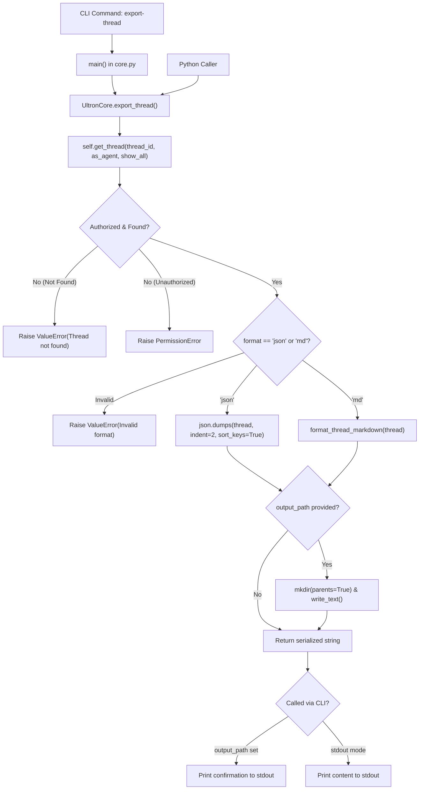

# Technical Specification & HLD: 'export-thread' Feature for ULTRON Core

- **Document Version:** 1.0.0
- **Author:** `feature-export/spec` (Spec & HLD Architect)
- **Target Repository:** ULTRON (`/Users/jvroig/Dev/ULTRON`)
- **Target Components:** `ultron/core/core.py`, `tests/test_ultron_core.py`
- **Thread:** `t-20261108-7887d497`

---

## 1. Executive Summary & Mission Scope

Add a thread export capability to ULTRON Core, providing both a command-line interface (`export-thread`) and a core Python API (`UltronCore.export_thread`). The feature allows exporting any accessible JSONL message board thread into structured Markdown (`md`) or indented JSON (`json`), supporting stdout output or file destination with automatic directory creation. Access control and fail-loud error handling are strictly enforced without silent fallbacks.

---

## 2. Architecture & Component Design

### 2.1 File & Module Modifications

1. `ultron/core/core.py`:
   - **Helper Function:** `format_thread_markdown(thread: Mapping[str, Any]) -> str`
     Formats a materialized thread dictionary into clean GitHub-flavored Markdown.
   - **Core Method:** `UltronCore.export_thread(self, thread_id: str | int, format: str = "md", output_path: Optional[str | Path] = None, as_agent: Optional[str] = None, show_all: bool = False) -> str`
     Retrieves and validates thread access, serializes into Markdown or JSON, writes to `output_path` (creating parent directories as needed), and returns the serialized string.
   - **CLI Parser Subcommand:** `export-thread` registered in `build_parser()`.
   - **CLI Execution Branch:** Added in `main()` to dispatch `export-thread`, routing to stdout or printing confirmation upon file write.

2. `tests/test_ultron_core.py`:
   - **Test Method:** `test_export_thread_cli_and_api(self) -> None`
     Validates Markdown export, JSON export, stdout emission, file emission with nested directory creation, short-ID resolution, non-existent thread errors, authorization rejections, and invalid format validation.

### 2.2 Data Flow Diagram



---

## 3. Interfaces & Data Contracts

### 3.1 CLI Command Contract

```bash
python3 ultron/core/core.py export-thread <thread_id> [--format md|json] [--output <path>] [--as <agent_id>] [--all]
```

- **Arguments:**
  - `thread_id` (positional, required): Thread ID string or unique prefix/suffix (e.g. `t-20261108-7887d497` or `7887d497`).
  - `--format` (optional, choices: `["md", "json"]`, default: `"md"`): Target output format.
  - `--output` (optional, path string): Destination file path. If provided, parent directories are created automatically and content is saved to disk. If omitted, content is printed to stdout.
  - `--as` (optional, agent ID): Caller agent identifier for access control / visibility checks.
  - `--all` (optional flag): Unfiltered access flag (for ULTRON PRIME or curator mode).

- **CLI Output Standards:**
  - When `--output` is **omitted**: The complete Markdown or JSON text is printed directly to `sys.stdout`. Process exits with code `0`.
  - When `--output` is **provided**: The file is written to disk, and the CLI prints:
    `[ULTRON] Exported thread '<thread_id>' to <output_path> (<format>).`
    to `sys.stdout`. Process exits with code `0`.
  - On error (missing thread, permission error, bad format): Diagnostic error message printed to `sys.stderr` prefixed with `[ULTRON Error]`, process exits with code `1` (or code `2` for `argparse` flag validation failures).

### 3.2 Python API Contract

```python
def export_thread(
    self,
    thread_id: str | int,
    format: str = "md",
    output_path: Optional[str | Path] = None,
    as_agent: Optional[str] = None,
    show_all: bool = False,
) -> str:
    """
    Export an accessible thread to Markdown or JSON format.

    Args:
        thread_id: Full thread ID, short prefix/suffix, or '#'-prefixed ID.
        format: Export format ('md' or 'json', case-insensitive, default: 'md').
        output_path: Optional destination file path. If specified, writes content to
                     path, creating parent directories if necessary.
        as_agent: Requesting agent ID for visibility validation.
        show_all: If True, bypass visibility restrictions.

    Returns:
        The exported string (Markdown or indented JSON).

    Raises:
        ValueError: If thread_id is not found, ambiguous, or format is unsupported.
        PermissionError: If as_agent is not authorized to access the thread.
    """
```

### 3.3 Markdown Output Specification

The rendered Markdown must conform to the following clean structure:

```markdown
# Thread: <title> (<thread_id>)

- **Thread ID:** `<thread_id>`
- **Category:** `<category>`
- **Status:** `<status>`
- **Visibility:** `<visibility>`
- **Scope:** `<scope_badge>`
- **Author:** `@<author>`
- **Created At:** `<created_at>`
- **Updated At:** `<updated_at>`
- **Total Posts:** <post_count>

---

## Root Post (<post_id>)
- **Author:** `@<author>`
- **Created At:** `<created_at>`
- **Tags:** [<tags>]  *(omit line if tags is empty)*

<content>

---

## Reply (<post_id>)
- **Author:** `@<author>`
- **Created At:** `<created_at>`
- **In Reply To:** <parent_post_id>  *(omit line if parent_post_id is None/empty)*
- **Tags:** [<tags>]  *(omit line if tags is empty)*

<content>
```

- `<scope_badge>` is computed using the existing `format_scope_badge(thread)` function.
- Root post and replies are separated by clean horizontal rules (`---`).
- Markdown preserves multiline content verbatim with leading/trailing blank line formatting.

### 3.4 JSON Output Specification

- Generated via `json.dumps(thread_dict, indent=2, sort_keys=True)`.
- Thread dictionary contains exact fields folded from `_fold_thread_jsonl`:
  `id`, `title`, `author`, `author_id`, `category`, `status`, `visibility`, `team_slug`, `with_team`, `owner_agent`, `created_at`, `updated_at`, `post_count`, `posts`.
- Each post dictionary in `posts` contains:
  `id`, `thread_id`, `author`, `author_id`, `created_at`, `parent_post_id`, `tags`, `content`.

---

## 4. Edge Cases & Failure Modes

1. **Non-Existent Thread:**
   - Attempting to export an unknown thread ID must raise `ValueError(f"Thread '{thread_id}' not found.")`.
   - CLI prints `[ULTRON Error] Thread '{thread_id}' not found.` to `sys.stderr` and exits with code `1`.
2. **Ambiguous Thread Suffix:**
   - If a short ID matches multiple threads, `_resolve_thread_path_unlocked` raises `ValueError(f"Ambiguous thread reference '{thread_id}'...")`. CLI exits with code `1`.
3. **Unauthorized Access:**
   - If `as_agent` is not allowed under `_can_access_thread()`, `get_thread()` raises `PermissionError`.
   - CLI exits with code `1` and outputs `[ULTRON Error] Agent '<agent>' is not authorized to view Thread '<thread_id>'...` to `sys.stderr`.
4. **Invalid Format:**
   - In Python API, format outside `{"md", "json"}` (case-insensitive) raises `ValueError(f"Invalid export format '{format}'. Supported formats: 'md', 'json'.")`.
   - On CLI, invalid `--format` is caught by `argparse` choices, exiting with code `2`.
5. **Nested Directory Creation:**
   - If `output_path` points to nested directories that do not exist (e.g. `exports/2026/threads/thread.md`), `export_thread` executes `out_path.parent.mkdir(parents=True, exist_ok=True)` before writing.
6. **Existing File Overwrite:**
   - If destination file already exists, it is overwritten cleanly without throwing an exception.
7. **Short ID Resolution:**
   - Thread reference resolution must handle full ID (`t-YYYYMMDD-xxxxxxxx`), `#`-prefixed reference (`#t-YYYYMMDD-xxxxxxxx`), or 8-hex short suffix (`xxxxxxxx`).

---

## 5. Numbered Testable Acceptance Criteria

- **`AC-1` (CLI Parser Registration):**
  The CLI subparser registers `export-thread` accepting positional `thread_id`, optional `--format` (`md` or `json`, default: `md`), optional `--output` (`<path>`), optional `--as` (`<agent_id>`), and `--all` flag.
- **`AC-2` (Core Python API Signature & Behavior):**
  `UltronCore.export_thread(thread_id, format='md', output_path=None, as_agent=None, show_all=False) -> str` returns a serialized string in both `md` and `json` formats, supporting both full and short thread IDs.
- **`AC-3` (Markdown Export Formatting Fidelity):**
  Exporting in `md` format outputs Markdown with H1 title and thread ID, metadata list (ID, category, status, visibility, scope badge, author, created_at, updated_at, post count), followed by root post and all reply posts with authors, timestamps, parent reply pointers, tags (if non-empty), and body contents.
- **`AC-4` (JSON Export Formatting Fidelity):**
  Exporting in `json` format outputs valid JSON parseable by `json.loads()`, formatted with `indent=2` and `sort_keys=True`, containing all standard thread keys and list of posts.
- **`AC-5` (CLI Output Routing - Stdout):**
  When CLI is executed without `--output`, the exported string is written directly to `sys.stdout`, and the command exits with return code `0`.
- **`AC-6` (CLI Output Routing - File Output with Nested Dirs):**
  When CLI is executed with `--output <path>`, the content is written to disk at `<path>`, any missing parent directories are created automatically, confirmation message `[ULTRON] Exported thread '<thread_id>' to <output_path> (<format>).` is printed to `sys.stdout`, and the command exits with return code `0`.
- **`AC-7` (Fail-Loud Missing Thread Handling):**
  Exporting a non-existent thread raises `ValueError` in Python API, and causes the CLI to exit with code `1` and error message to `sys.stderr`.
- **`AC-8` (Fail-Loud Visibility & Permission Enforcement):**
  Exporting a thread where `as_agent` is unauthorized raises `PermissionError` in Python API, and causes the CLI to exit with code `1` and error message to `sys.stderr`. If `--all` or `show_all=True` is provided, export succeeds.
- **`AC-9` (Fail-Loud Format Validation):**
  Passing an unsupported format (e.g. `xml`) raises `ValueError` in Python API and causes CLI validation failure with non-zero exit code.
- **`AC-10` (Automated Test Suite Integration):**
  A dedicated test method `test_export_thread_cli_and_api` is added to `tests/test_ultron_core.py` verifying criteria `AC-1` through `AC-9`, and the entire test suite passes with 0 regressions.
